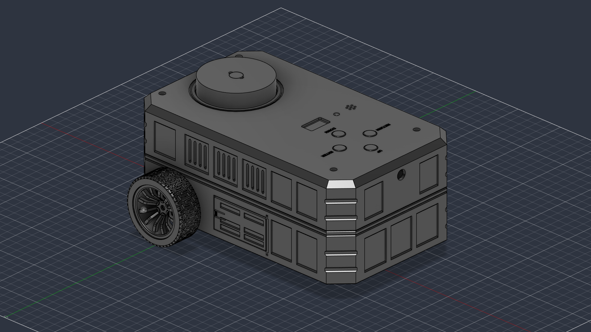
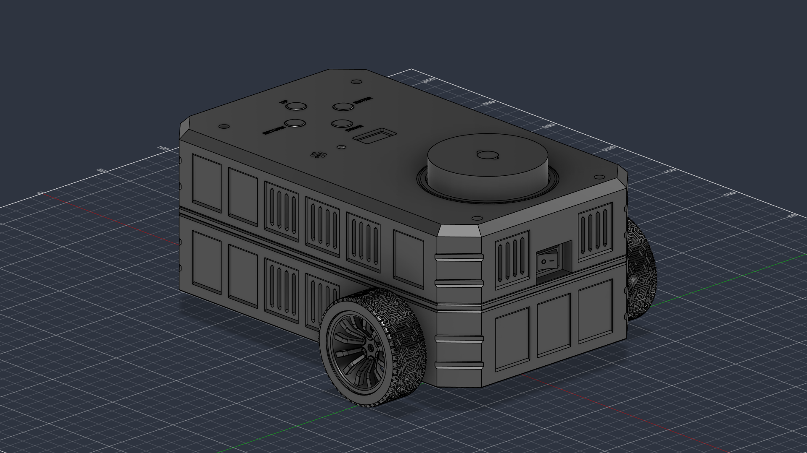
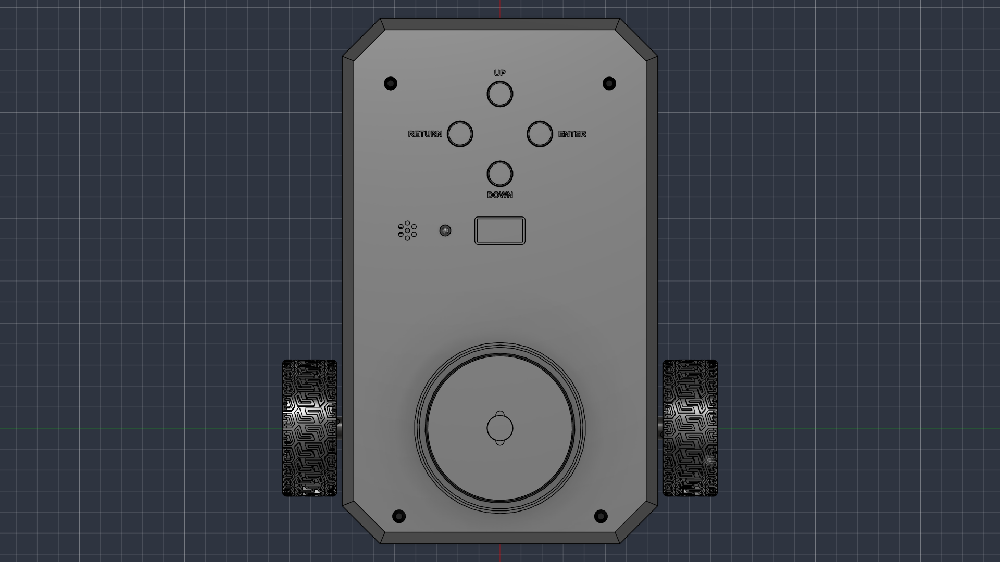
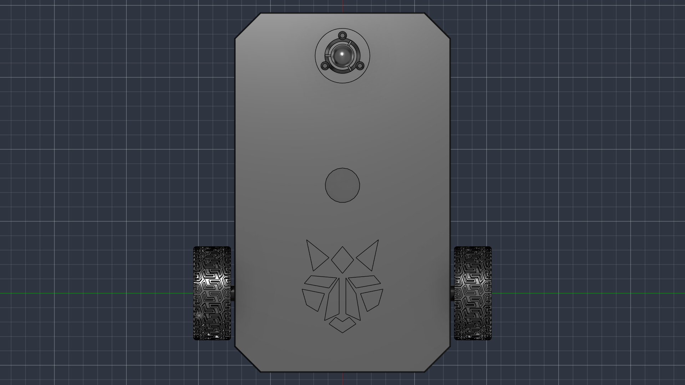

# ROS 2 Differential-Drive Mobile Robot — Autodesk Fusion 360 CAD & Simulation Suite

> [!NOTE]
> **FreeCAD Port Notice**: This project is a direct port to **Autodesk Fusion 360** (automated via the official Autodesk Fusion MCP Server) of the original open-source FreeCAD project: [**`med-yassine-ben-salah/ros2-diffdrive-robot-cad`**](https://github.com/med-yassine-ben-salah/ros2-diffdrive-robot-cad). All mechanical dimensions, mounting patterns, clearances, and ROS 2 coordinate conventions are 100% matched between both CAD implementations.

Compact, fully parametric, FDM-printable **ROS 2 differential-drive mobile robot** (`250 × 150 mm` footprint, `112.0 mm` enclosure height, `126.5 mm` total height with LiDAR turret) ported and natively configured for **Autodesk Fusion 360** around 14 reference CAD components.

| Isometric Front View | Isometric Rear View |
|---|---|
|  |  |

---

## Key Features & Mechanical Architecture

- **Exact `250 × 150 mm` Enclosure Footprint**: Rounded rectangular chassis (`R = 18 mm` vertical corners, `4.5 mm × 45°` upper crown bevels) with `14.0 mm` ground clearance and `< 150 mm` non-LiDAR height (`112.0 mm` roof).
- **Rear Differential Drivetrain**: `2× JGA25-371` geared DC motors with quadrature encoders mounted via inverted brackets on a `6.0 mm` internal structural motor bridge, driving collinear `Ø65 mm` rubber wheels (`X = 0.0, Z = 32.5 mm`, `55.0 mm` forward of the rear edge, `WHEEL_TRACK = 181.0 mm`, `wheel_separation = 0.1810 m`). Generous `1.074 mm` running clearance to brackets.
- **Serviceable Front Ball Caster**: Custom snap-in `5/8"` (`15.875 mm`) steel ball caster at `(X = 165.0, Y = 0.0) mm` with `6.2 mm` ground clearance and $45^\circ$ ski bevel, removable from underneath via `3× M3` screws without dismantling the robot.
- **Buried `LDS02RR` 360° LiDAR**: Mounted on an unmodified `LDS02RR_Plate` supported by `4×` stepped pillars (`12.4 mm` height, `Z = 77.4..81.4 mm`) and `M3` clamp caps on the electronics deck. Plate locating pins engage directly inside all 4 scanner ear mounting holes. Turret center is aligned with the wheel axle midpoint `(0.0, 0.0)`; the stationary base is `100%` hidden inside the upper shell (`Z <= 108.0 mm`) while the rotating optical head protrudes through a `Ø71.3 mm` circular collar (`Z = 112.0..126.5 mm`) with an unobstructed `360°` horizontal scan field.
- **`MPU9250` IMU at Support-Triangle Centroid**: Mounted horizontally in standard ROS 2 orientation (`+X` forward, `+Y` left, `+Z` up) at `(X = 55.00, Y = 0.00) mm` — the exact centroid of the left wheel `(0, +90.50)`, right wheel `(0, -90.50)`, and front ball caster `(165.0, 0)`.
- **Electronics & Computing Standoffs**: Dedicated mounting provisions for Raspberry Pi 4/5 ($58 \times 49\text{ mm}$ pattern, 4x M2.5) and dual H-bridge motor driver ($45 \times 35\text{ mm}$ pattern, 4x M3) on the electronics deck.
- **Tool-Less Side Battery Bay**: Low-CG compartment (`X = 75.0, Y = 0.0, Z = 21.5 mm`) housing the `3×18650` battery holder behind a flush **snap-fit pivot hinge side door with cantilever latch lock** (`Y = -75.0 mm`, forward hinge at `X = 107.0 mm`, `90°–100°` outward swing corridor clearance).
- **Integrated Top UI Panel, Front Camera & Bumper-Recessed Power Switch**:
  - Rear-facing `0.96"` I2C OLED display behind a PCB-masking bezel window (`13 × 24 mm`).
  - `4×` `12 mm` tactile switches + black caps in a diamond layout (`UP`, `DOWN`, `RETURN`, `ENTER`) with engraved legends.
  - `5 mm` RGB status LED dome and `Passive_Buzzer` beneath a 7-hole acoustic grille.
  - Front centerline `ESP32-CAM + MB` programmer stack (`Y = 0.0, Z = 98.5 mm`) on a custom U-bracket behind a clean `Ø10.0 mm` lens aperture.
  - Rear panel-mount `ON/OFF` rocker switch recessed $7.5\text{ mm}$ into a protective bumper well housing (`X_rocker = -54.45 mm` safely behind `X_MIN = -55.0 mm` bumper plane).

| Top View | Bottom View |
|---|---|
|  |  |

---

## Repository Structure

```text
.
├── models/                                 # 14 reference component STEP/STL CAD models
├── ros2_diffdrive_description/             # Complete ROS 2 URDF & Xacro package for RViz2, Nav2, Gazebo & ros2_control
│   ├── urdf/ros2_diffdrive_robot.urdf.xacro # Full parametric Xacro (ros2_control, Gazebo sensors, contact friction)
│   ├── urdf/ros2_diffdrive_robot.urdf      # Standalone URDF
│   ├── config/my_bot_controllers.yaml      # ros2_control diff_drive_controller config
│   ├── meshes/                             # 17 metres-scaled (x0.001) link-centered STL meshes
│   ├── launch/display.launch.py            # Starts robot_state_publisher, joint_state_publisher_gui & rviz2
│   ├── rviz/display.rviz                   # Pre-configured RViz2 layout
│   ├── package.xml                         # ament_cmake ROS 2 package manifest
│   └── CMakeLists.txt                      # ament_cmake build configuration
├── robot/
│   ├── parameters.py                       # Single-source parametric constants & derivation chains
│   ├── helpers.py                          # Fusion 360 API utilities (B-Rep, parameters, camera, materials)
│   ├── stage1_chassis_drivetrain.py        # Stage 1: Lower chassis, door, caster, drivetrain, battery
│   ├── stage2_deck_lidar_imu.py            # Stage 2: Electronics deck, LiDAR pillars, LiDAR, IMU
│   ├── stage3_upper_enclosure_ui.py        # Stage 3: Upper enclosure, UI carrier, camera bracket, UI/CAM/switch
│   ├── robot_build.py                      # Master build, modeling & assembly runner
│   ├── verify_all.py                       # Consolidated mechanical & geometric verification suite
│   ├── render_views.py                     # Automated 8-view viewport renderer
│   ├── export_all.py                       # STEP & STL exporter
│   ├── previews/                           # High-resolution rendered assembly PNGs
│   └── export/                             # Watertight STLs, assembly STEP files & URDF
├── fusion-mcp-workflow.md                  # Complete Fusion MCP Server automation & porting guide
└── README.md                               # This documentation
```

---

## Native Parametric Controls in Autodesk Fusion 360

When opened in Autodesk Fusion 360, navigate to **Modify > Change Parameters** (`fx`). The following user parameters are dynamically bound to the model:

| Parameter | Value | Unit | Description |
| :--- | :--- | :--- | :--- |
| `CHASSIS_L` | `250` | mm | Overall longitudinal chassis length |
| `CHASSIS_W` | `150` | mm | Overall lateral chassis width |
| `GROUND_CLEARANCE` | `14` | mm | Clearance beneath lower chassis plate |
| `WHEEL_D` | `65` | mm | Drive wheel diameter |
| `WHEEL_TRACK` | `181` | mm | Center-to-center track width ($0.1810\text{ m}$) |
| `CASTER_X` | `165` | mm | Longitudinal coordinate of front ball caster |
| `CASTER_BALL_D` | `15.875` | mm | Ball caster diameter ($5/8"$) |
| `IMU_CENTROID_X`| `55` | mm | Support-triangle centroid X coordinate |
| `Z_ROOF_TOP` | `112` | mm | Upper enclosure roof height |
| `Z_LIDAR_ORIGIN`| `108` | mm | Height of stationary LiDAR base datum |
| `LIDAR_NECK_CUT_R`| `35.65` | mm | Radius of roof aperture for rotating turret |
| `BATT_X` | `75` | mm | Longitudinal center of 3x 18650 battery bay |

---

## How to Run & Automate in Fusion 360

### Option 1: Via Official Fusion MCP Server (from Antigravity / AI Agent)
The model can be rebuilt, verified, and rendered live in Fusion using MCP tool execution:
```python
# Rebuild the full assembly in the active Fusion window:
fusion_mcp_execute(featureType="script", object={"script": """
import sys
sys.path.insert(0, r"C:\\Users\\yassine\\Desktop\\antigravity_ws_2\\Fusion_ws\\robot")
import robot_build
def run(_context: str):
    robot_build.run(_context)
"""})
```

### Option 2: Directly Inside Autodesk Fusion 360
1. Open Autodesk Fusion 360.
2. Press **Shift + S** (or go to **Utilities > Scripts and Add-Ins**).
3. Under the **Scripts** tab, click the green **`+`** icon.
4. Select `C:\Users\yassine\Desktop\antigravity_ws_2\Fusion_ws\robot\robot_build.py`.
5. Select the script and click **Run**.

---

## ROS 2 Simulation & Hardware Deployment (`ros2_diffdrive_description`)

The included ROS 2 description package is fully configured for ROS 2 Humble/Iron/Jazzy:

```bash
# 1. Copy ros2_diffdrive_description to your ROS 2 workspace src directory:
cp -r ros2_diffdrive_description ~/ros2_ws/src/

# 2. Build the workspace:
cd ~/ros2_ws
colcon build --packages-select ros2_diffdrive_description
source install/setup.bash

# 3. Launch RViz2 and state publishers:
ros2 launch ros2_diffdrive_description display.launch.py
```
